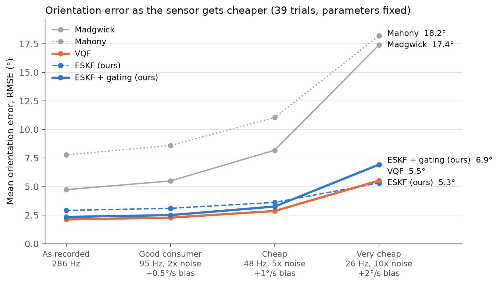
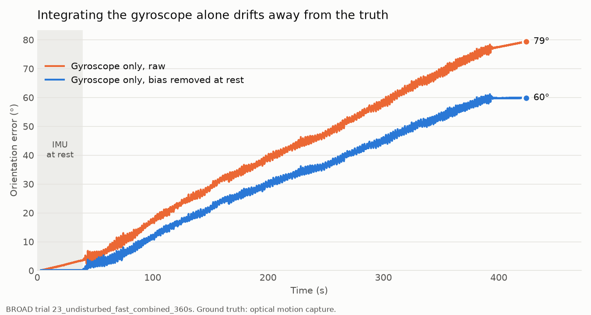
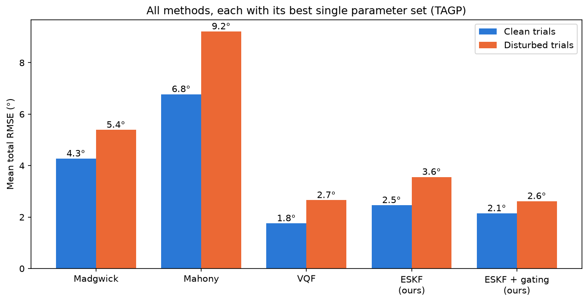
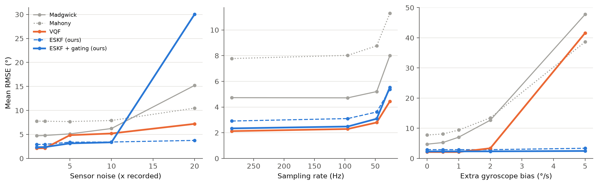

# Robust orientation estimation under magnetic and motion disturbances

How well can a low-cost IMU (gyroscope, accelerometer, magnetometer) track its
own 3D orientation when magnets, steel and fast motion get in the way, and what
happens as the sensor gets cheaper?

This repository compares four standard filters and an error-state Kalman filter
(ESKF) written for this project. All of them are tuned the same way and
scored against optical motion-capture ground truth on the public
[BROAD dataset](https://github.com/dlaidig/broad) (Laidig et al., 2021, CC BY 4.0).
BROAD has 39 recordings, 16 of them with deliberate disturbances: tapping,
vibration, magnets near the sensor or attached to it, and an office
environment.



*Mean orientation error over all 39 trials as the recorded data are made to
look like cheaper sensors: lower sampling rate, more noise and more gyroscope
bias, all at once. Every method keeps the parameters tuned on the original
data. On the cheapest sensor the gated ESKF falls behind the plain one. Its
fixed magnetic-disturbance thresholds start mistaking noise for disturbances;
see [What did not work](#what-did-not-work-and-what-we-learned).*

## Main results

| | Clean trials (23) | Disturbed trials (16) |
|---|---|---|
| Madgwick, tuned | 4.3° | 5.4° |
| Mahony, tuned | 6.8° | 9.2° |
| **VQF**, tuned | **1.8°** | 2.7° |
| ESKF (ours), tuned | 2.5° | 3.6° |
| ESKF + magnetic gating (ours), tuned | 2.1° | 2.6° |

Mean total orientation RMSE. Every method uses its own best single parameter
set for all trials (see [fair tuning](#step-3-fair-tuning)).

- **VQF is the most accurate filter overall:** 2.13° mean over all 39 trials,
  against 2.34° for the gated ESKF. VQF was developed by the authors of the
  BROAD dataset. On the disturbed trials the two are level (2.62° vs 2.66°).
  The gap is on clean trials, and it is almost all heading error during long
  rotations.
- **Magnetic gating cuts the ESKF's error on disturbed trials from 3.6° to
  2.6°.** With a magnet attached 1 cm from the sensor (trial 32), the error is
  2.0° with gating, compared with 8.9° without it and 6.0° for VQF.
- **The ESKF copes best with noise and with large gyroscope bias.** At 10x the
  recorded sensor noise it reaches 3.4° vs 5.2° for VQF. With an extra
  gyroscope bias of 5°/s it reaches 2.5°, while every other filter fails
  (38 to 48°).
  For VQF this comes from its default bias limit of 2°/s; with the limit raised
  to 10°/s VQF recovers (1.3 to 3.8° on the three trials tried). The practical
  lesson: check a filter's bias limit against the gyroscope's zero-rate offset
  in its datasheet.
- **VQF copes best with low sampling rates.** At 26 Hz: VQF 4.4°, ESKF 5.4°.

## Reproduce

Python 3.11 or newer.

```bash
python3 -m venv .venv
.venv/bin/pip install -r requirements.txt
./run_all.sh
```

`run_all.sh` downloads the dataset (about 170 MB) and recreates every number
and figure in this README. The filters run in parallel on all but one CPU
core, and the whole run takes about an hour on a 14-core laptop, most of it
for the parameter search. Run from a clean copy of the repository, it took
52 minutes and reproduced every result file in `results/` byte for byte.

## The problem in one paragraph

A gyroscope measures how fast the sensor turns. Adding up those turns gives
the orientation, but every small error is added up too, so the estimate
drifts. The accelerometer shows which way is down, but only while the sensor
is not accelerating. The magnetometer shows which way is north, but only
while no magnet, steel or electric current is nearby. A filter has to decide,
moment by moment, how much to trust each sensor.

## Step 1: gyroscope only

```bash
.venv/bin/python scripts/gyro_only.py
```

Integrating the gyroscope alone, starting from the true orientation:

| Variant | Mean total RMSE over 39 trials |
|---|---|
| Raw gyroscope | 32.6° |
| Bias removed once, at rest | 8.0° |

Removing the gyroscope bias measured at rest helps a lot, but the estimate
still drifts during long and fast motions. The drift has to be corrected all
the time from the accelerometer and magnetometer.



## Step 2: standard filters with their default parameters

```bash
.venv/bin/python scripts/run_baselines.py --methods madgwick mahony vqf
.venv/bin/python scripts/plot_baselines.py
```

| Method | Clean trials | Disturbed trials |
|---|---|---|
| Madgwick (`ahrs`) | 5.3° | 5.7° |
| Mahony (`ahrs`) | 22.4° | 36.6° |
| VQF (`vqf`, real-time version) | 1.8° | 3.0° |

The `vqf` package also has an offline VQF that looks at future samples. No
real-time filter can do that, so the real-time version is used throughout.
The offline version would score 2.5° on the disturbed trials.

Default parameters say more about a library's defaults than about the method.
Mahony's defaults in particular do not suit this data, so every method is
tuned next.

## Step 3: fair tuning

```bash
.venv/bin/python scripts/tune.py
.venv/bin/python scripts/run_baselines.py --params results/tagp.json --out results/tuned.csv
```

For each method, a grid search finds the one parameter set with the lowest
mean error over all 39 trials. The BROAD paper calls this TAGP
(trial-agnostic good parameters): one setting that has to work everywhere, as
it would in a product.

- Every method gets a grid of similar size: 12 to 42 parameter sets, over the
  same objective and the same data.
- Our ESKF has two tuned parameters, like Mahony and VQF: how much to trust
  the accelerometer and how much to trust the magnetometer. Everything else
  in it is fixed.
- No winning value lies on the edge of its grid (checked by the script).
- The search is in-sample: tuned and scored on the same 39 trials, as in the
  BROAD paper, and equally so for every method.

| Method | Parameters (TAGP) | Clean | Disturbed | Heading | Inclination |
|---|---|---|---|---|---|
| Madgwick | gain = 0.07 | 4.3° | 5.4° | 3.9° | 2.5° |
| Mahony | k_P = 1, k_I = 0.001 | 6.8° | 9.2° | 6.3° | 4.2° |
| VQF | tauAcc = 3 s, tauMag = 20 s | 1.8° | 2.7° | 2.0° | 0.7° |
| ESKF (ours) | acc_noise = 0.1, mag_noise = 1 | 2.5° | 3.6° | 2.7° | 0.9° |
| ESKF + gating (ours) | acc_noise = 0.05, mag_noise = 0.3 | 2.1° | 2.6° | 2.1° | 0.8° |

Heading is the error around the vertical axis (which way the sensor points).
Inclination is the tilt error. Most of every filter's error is heading,
because north comes only from the magnetometer, the least reliable sensor.



Mean total error by kind of trial (bold = best):

| Trials | n | Madgwick | Mahony | VQF | ESKF | ESKF + gating |
|---|---|---|---|---|---|---|
| slow rotation | 5 | 2.1° | 2.9° | **1.4°** | 2.8° | 1.8° |
| fast rotation | 4 | 3.6° | 3.9° | **2.9°** | 3.9° | 3.4° |
| slow translation | 5 | 2.6° | 4.5° | **1.0°** | 1.3° | 1.5° |
| fast translation | 4 | 8.1° | 17.3° | **1.0°** | 1.4° | 1.5° |
| slow combined | 2 | 2.6° | 1.8° | 1.1° | **0.9°** | 1.2° |
| fast combined | 3 | 7.8° | 10.1° | 3.5° | 4.3° | **3.5°** |
| tapping | 2 | 2.4° | 3.9° | 1.6° | **1.4°** | 1.5° |
| phone vibration | 2 | 7.4° | 5.0° | 4.3° | 4.3° | **4.2°** |
| stationary magnet | 4 | 4.5° | 10.4° | **2.6°** | 3.9° | 2.8° |
| attached magnet | 5 | 6.9° | 14.3° | 3.1° | 3.8° | **2.4°** |
| office | 2 | 5.6° | 4.6° | **1.8°** | 4.7° | 3.1° |
| mixed | 1 | 2.9° | 7.6° | **1.1°** | 1.2° | 1.1° |

Bold marks the lowest unrounded value, so two equal-looking numbers can have
a single bold entry.

**Out-of-sample check.** The search above is in-sample. To see how much that
flatters each method, every trial was also scored with the parameter set that
is best on the other 38 trials (`scripts/report.py`, from the stored
`results/tuning.csv`):

| Method | Tuned on all 39 trials | Each trial tuned on the other 38 |
|---|---|---|
| Madgwick | 4.73° | 4.73° |
| Mahony | 7.77° | 8.07° |
| VQF | 2.13° | 2.13° |
| ESKF (ours) | 2.91° | 3.05° |
| ESKF + gating (ours) | 2.34° | 2.34° |

The parameter choice of VQF and the gated ESKF does not depend on any single
trial. This covers the two tuned parameters only, not the structural choices
described [below](#what-did-not-work-and-what-we-learned).

## Our filter: an error-state Kalman filter

[`src/eskf.py`](src/eskf.py) estimates the orientation and the gyroscope bias.
It keeps a best guess and runs a Kalman filter on the small error of that
guess. Every sample, it does four things:

1. **Predict:** turn the orientation by the bias-corrected gyroscope reading.
   The uncertainty grows.
2. **Rest update:** when the sensor has been still for 1.5 s, the gyroscope
   should read zero, so its reading is the bias. This is the zero angular rate
   update from inertial navigation.
   - Once the bias has been measured at rest, it is held fixed in motion. The
     accelerometer and magnetometer then correct only the orientation (see
     [what we learned](#what-did-not-work-and-what-we-learned)).
   - Before the first rest they may still set the bias. Rest is detected on
     the bias-corrected turn rate, so even a large uncalibrated bias is found
     first and then refined at rest.
3. **Accelerometer update:** correct the tilt.
   - At rest, the raw reading is pure gravity and is trusted a lot.
   - In motion, the reading is first averaged over 3 s in the earth frame.
     The sensor's own acceleration only changes its velocity, which stays
     bounded, so it averages out and gravity remains. This idea is from VQF
     (Laidig & Seel, 2023).
4. **Magnetometer update:** correct the heading only, never the tilt, so a
   disturbed magnetic field cannot tip the estimate over.

**Magnetic gating** (the gated variant) checks the magnetometer before using
it:

- The field's strength and dip angle are compared with the Earth field seen
  earlier. If they differ by more than 10% or 10° (VQF's published thresholds),
  the reading is skipped.
- After a disturbance, the field must look right for 0.5 s before it is used
  again.
- A reading that agrees with the field but surprises the filter more than its
  own uncertainty can explain (chi-square test) is trusted less.

## Step 4: cheaper sensors

```bash
.venv/bin/python scripts/cheap_sensor.py
.venv/bin/python scripts/plot_cheap_sensor.py
```

[`src/degrade.py`](src/degrade.py) makes the recorded data look like a cheaper
IMU in three ways:

- **More noise:** white noise added to all three sensors.
- **Lower sampling rate:** blocks of samples are averaged and one sample per
  block is kept, giving 95, 48 and 26 Hz.
- **More gyroscope bias:** a constant offset in a random direction.

All methods keep their tuned parameters. The question is how robust each one
is out of the box, not how well it could be retuned.



| Condition | Madgwick | Mahony | VQF | ESKF | ESKF + gating |
|---|---|---|---|---|---|
| As recorded | 4.7° | 7.8° | **2.1°** | 2.9° | 2.3° |
| 5x noise | 5.1° | 7.7° | 4.8° | 3.4° | **3.1°** |
| 10x noise | 6.2° | 7.9° | 5.2° | 3.4° | **3.4°** |
| 20x noise | 15.2° | 10.5° | 7.2° | **3.8°** | 30.1° |
| 48 Hz | 5.2° | 8.8° | **2.8°** | 3.6° | 3.1° |
| 26 Hz | 8.0° | 11.3° | **4.4°** | 5.4° | 5.5° |
| +2°/s gyro bias | 12.7° | 13.5° | 3.4° | 2.9° | **2.4°** |
| +5°/s gyro bias | 47.8° | 38.6° | 41.6° | 3.4° | **2.5°** |
| Very cheap (26 Hz, 10x noise, +2°/s) | 17.4° | 18.2° | 5.5° | **5.3°** | 6.9° |

The ESKF has no bias limit because the bias is part of its Kalman state.
Until the first rest, the accelerometer and magnetometer updates correct the
bias as well. Rest is detected on the bias-corrected turn rate, so a 5°/s
offset does not hide it.

## What did not work, and what we learned

The ESKF's structure was shaped by looking at errors on a few benchmark
trials. These were trials 15, 30, 32, 36 and 37, plus an eight-trial
comparison set, and trials 01 and 04 for holding the bias in motion. So the
structural choices are in-sample. Only its two noise
parameters went through the same TAGP search as every other method. VQF's
internal defaults were likewise developed by its authors on this dataset.
The gating thresholds were taken from VQF's published values, not fitted.
These attempts made things worse, or failed until fixed:

- **Trusting the accelerometer less when its magnitude is not 1 g** made the
  tilt worse, not better. The readings that pass are a biased subset: a
  sideways acceleration barely changes the magnitude but tilts the direction.
  Averaging in the earth frame plus rest detection handles this instead.
- **Learning the gyroscope bias in motion** made it wander. On trial 01 the
  bias measured at rest is 0.47°/s, both before and after the motion. During
  the motion the filter's estimate swung between 0.2 and 0.6°/s, and the
  heading error grew to 6° with it. Errors from the averaged accelerometer
  and from the uneven lab field look like bias to the filter. Holding the bias
  fixed in motion, once it has been measured at rest, fixed this. With both
  noise parameters retuned, the gated ESKF's mean error fell from 2.60° to
  2.34° (clean trials 2.45° to 2.14°). With 5°/s of extra bias it fell from
  3.5° to 2.5°, helped by detecting rest on the bias-corrected rate. It cost
  a little on the noisiest sensors: 3.0° to 3.4° at 10x noise. The price in
  principle: a bias that changes during a long motion, for example as the
  sensor warms up, is only corrected at the next rest.
- **More gyroscope uncertainty at high turn rates** (to model scale-factor
  error) made the filter worse. It was tried on all axes and on heading only.
  On all axes, the filter leaned on the accelerometer exactly when the
  accelerometer was least reliable. The idea was dropped. Scale-factor error
  is real here: even with the bias removed, the gyroscope alone reaches 10.6°
  RMSE on trial 01 (Step 1).
- **Checking the magnetometer sample by sample** was fooled in two ways:
  - Sensor noise looked like a disturbance and made the filter reject good
    readings.
  - Single disturbed samples that happened to pass the check slipped through.

  Low-pass filtering the strength and dip, plus the 0.5 s consistency rule,
  fixed both.
- **Fixed gating thresholds do not transfer to a much noisier sensor.** On a
  clean trial at 20x noise, the gate rejects 93% of the (undisturbed)
  magnetometer readings, for up to 62 s at a time. The heading then runs on
  the gyroscope alone. On the very cheap sensor the gated filter is worse than the
  plain one (6.9° vs 5.3°). A fix would scale the thresholds and the low-pass
  window with the noise measured during the initial rest. That is not done
  here.
- **Vibration is the disturbance no check catches.** The worst trial of the
  gated ESKF (27, phone vibration, 6.6°) is also VQF's worst (6.9°). To every
  check, vibration looks like ordinary fast motion.
- **Even the "undisturbed" lab field is not perfect.** On three undisturbed
  trials checked, the field's direction (computed with the true orientation)
  varies by 10 to 15° (95th percentile) during motion. In a fast translation
  trial, its strength differs from the value at the start by about 8%
  (median). This limits how much any filter can trust the magnetometer.
- **A tilt error leaks into heading.** The magnetometer's heading depends on
  the estimated tilt. The field here dips about 70°, so every degree of tilt
  error becomes up to tan(70°) ≈ 2.7° of apparent heading error.

## Repository layout

| Path | Contents |
|---|---|
| `src/broad.py` | Loading BROAD trials |
| `src/quat.py`, `src/metrics.py` | Quaternions; BROAD's error metrics (total, heading, inclination) |
| `src/eskf.py` | Our error-state Kalman filter |
| `src/methods.py` | All methods behind one interface, plus a parallel runner |
| `src/degrade.py` | Making data look like a cheaper sensor |
| `scripts/` | One script per step; `report.py` prints the tables above |
| `results/` | CSV files with every per-trial result, and the figures |
| `run_all.sh` | Everything, in order |
| `docs/technical_note.pdf` | Two-page summary of the results |

## References

- D. Laidig, M. Caruso, A. Cereatti, T. Seel. "BROAD - A Benchmark for Robust
  Inertial Orientation Estimation." *Data* 2021, 6(7), 72.
  [doi:10.3390/data6070072](https://doi.org/10.3390/data6070072)
- D. Laidig, T. Seel. "VQF: Highly Accurate IMU Orientation Estimation with
  Bias Estimation and Magnetic Disturbance Rejection." *Information Fusion*
  2023, 91, 187-204.
  [doi:10.1016/j.inffus.2022.10.014](https://doi.org/10.1016/j.inffus.2022.10.014)
- S. Madgwick, A. Harrison, R. Vaidyanathan. "Estimation of IMU and MARG
  orientation using a gradient descent algorithm." *IEEE ICORR* 2011.
- R. Mahony, T. Hamel, J.-M. Pflimlin. "Nonlinear Complementary Filters on the
  Special Orthogonal Group." *IEEE Transactions on Automatic Control* 2008.
- J. Solà. "Quaternion kinematics for the error-state Kalman filter."
  arXiv:1711.02508, 2017.

The BROAD data are not included in this repository; `scripts/download_data.py`
fetches them from the original source under CC BY 4.0.
